<p align="center">
  
</p>

<p align="center">
  
  
  
  
  
  
</p>

<p align="center">
  <b>AI-powered road damage detection, from dashcam imagery to road-condition intelligence.</b><br>
  A controlled benchmark of four nano YOLO detectors on RDD2022, trained under an identical compute budget and replicated across seeds.
</p>

---

## ✨ Highlights

> **YOLOv8n is the best accuracy–speed trade-off.** Averaged over two training seeds, it reaches **mAP@50:95 = 0.312** and **mAP@50 = 0.579** on the held-out RDD2022 test split at **8.8 ms per image** on the GPU.

- 🏁 **Fair comparison:** YOLOv5nu, YOLOv8n, YOLO11n and YOLO12n each trained for exactly **6.0 h** on the same frozen dataset (fingerprint `5606829e…`) with the same hyper-parameters.
- 🔁 **Replicated:** every model was trained with **two seeds (42 and 2)**, 8 runs in total. The mAP@50:95 ranking **v8n > 12n > 11n > v5nu** is the same in both seeds.
- 📐 **Statistically tested:** paired bootstrap on the test set. v8n and 12n are statistically tied (p = 0.96 and 0.90). v5nu is significantly last in both seeds.
- ⚡ **Deployment pick, YOLOv8n:** it matches 12n's accuracy at **~1.7× lower GPU latency** (8.8 ms vs 15.0 ms).

---

## 🎬 See it in action

<p align="center">
  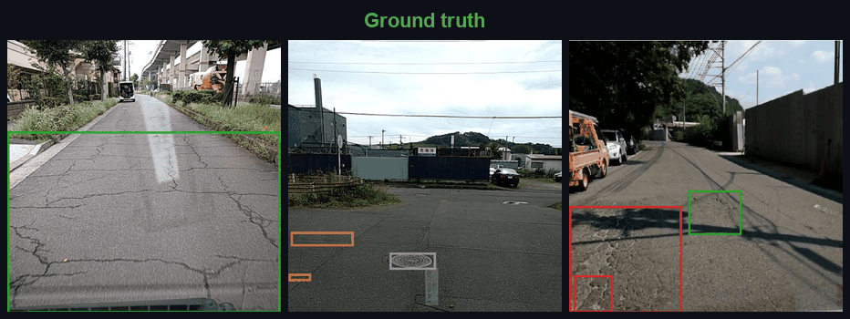
  <br><sub>Cycles through ground truth → YOLOv5nu → YOLOv8n → YOLO11n → YOLO12n on three test images (confidence ≥ 0.25).</sub>
</p>

---

## 🧠 Pipeline

<p align="center">
  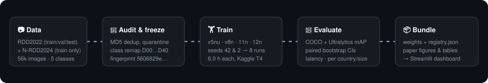
</p>

---

## 📊 Final results

<p align="center">
  
</p>

### Accuracy (held-out RDD2022 test, mean of seeds 42 and 2)

| Model | mAP@50 | mAP@50:95 | Pothole AP@50 | Epochs in 6 h | Rank (both seeds) |
| --- | ---: | ---: | ---: | ---: | :---: |
| **YOLOv8n** 🥇 | **0.579** | **0.312** | **0.460** | 37 | 1 |
| YOLO12n | 0.576 | 0.311 | 0.455 | 28.5 | 2 |
| YOLO11n | 0.568 | 0.306 | 0.439 | 36 | 3 |
| YOLOv5nu | 0.550 | 0.289 | 0.425 | 37 | 4 |

Seed-to-seed spread is small: the SD of mAP@50:95 is at most 0.003 for every model.

### Cost (seed 42 runs)

| Model | Params (M) | GFLOPs | Weights (MB) | GPU latency (ms) | GPU FPS | CPU latency (ms) |
| --- | ---: | ---: | ---: | ---: | ---: | ---: |
| YOLOv5nu | 2.64 | 7.7 | 5.5 | 9.3 | 108 | **63.9** |
| **YOLOv8n** | 3.14 | 8.8 | 6.5 | **8.8** | **114** | 70.3 |
| YOLO11n | 2.61 | **6.6** | 5.5 | 10.2 | 98 | 72.0 |
| YOLO12n | **2.58** | 7.5 | 5.6 | 15.0 | 67 | 92.9 |

Latency is end-to-end at batch 1 and 640 px.

### Statistical significance (paired bootstrap, mAP@50)

| Comparison | Seed 42 | Seed 2 |
| --- | --- | --- |
| v8n vs 12n | tie (p = 0.96) | tie (p = 0.90) |
| v8n vs 11n | tie (p = 0.27) | **v8n better** (p < 0.001) |
| 12n vs 11n | tie (p = 0.23) | **12n better** (p < 0.001) |
| v5nu vs every other model | **v5nu worse** (p < 0.001) | **v5nu worse** (p < 0.001) |

YOLO11n's gap only appears in one seed, so its third place is **not robust**.

<details>
<summary><b>📈 Per-class AP@50 (seed 42)</b></summary>

| Model | Longitudinal | Transverse | Alligator | Other Corruption | Pothole |
| --- | ---: | ---: | ---: | ---: | ---: |
| YOLOv5nu | 0.545 | 0.521 | 0.654 | 0.606 | 0.419 |
| YOLOv8n | **0.573** | **0.554** | 0.677 | 0.620 | **0.457** |
| YOLO11n | 0.563 | 0.539 | 0.671 | 0.629 | 0.433 |
| YOLO12n | 0.561 | 0.542 | **0.678** | **0.636** | 0.447 |

**Pothole** is the hardest class for every model, and **Alligator Crack** is the easiest.

<p align="center">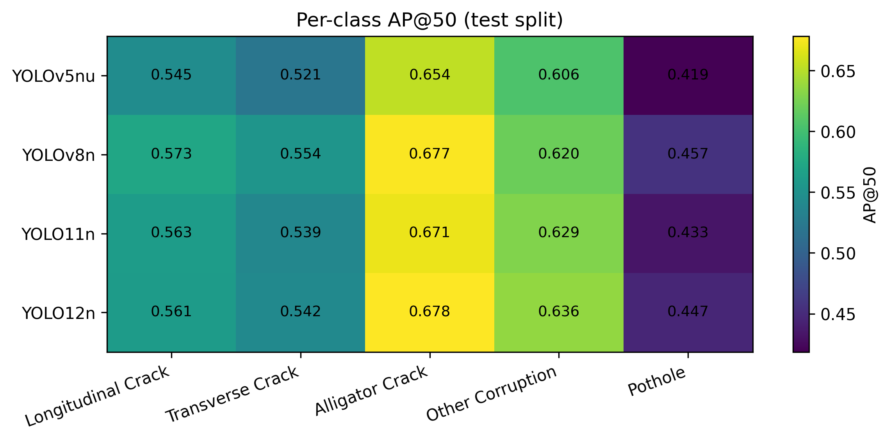</p>
</details>

<details>
<summary><b>🌍 Per-country AP@50 (seed 42)</b></summary>

| Country | YOLOv5nu | YOLOv8n | YOLO11n | YOLO12n |
| --- | ---: | ---: | ---: | ---: |
| China (MotorBike) | 0.825 | 0.894 | **0.907** | 0.897 |
| United States | 0.607 | **0.627** | 0.588 | 0.595 |
| Japan | 0.561 | 0.578 | 0.571 | **0.582** |
| China (Drone) | 0.497 | 0.566 | 0.542 | **0.587** |
| Czech | 0.348 | 0.339 | **0.389** | 0.356 |
| India | 0.280 | 0.292 | **0.299** | 0.287 |
| Norway | 0.185 | **0.205** | 0.200 | **0.205** |

Accuracy depends far more on the **country/domain** (0.19 to 0.91) than on the model (at most 0.09 within any one country). That makes cross-domain generalisation the biggest open problem.

<p align="center">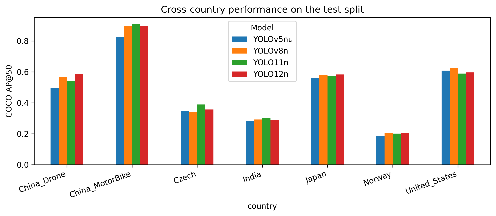</p>
</details>

<details>
<summary><b>🖼️ More figures</b></summary>

| | |
| :---: | :---: |
| 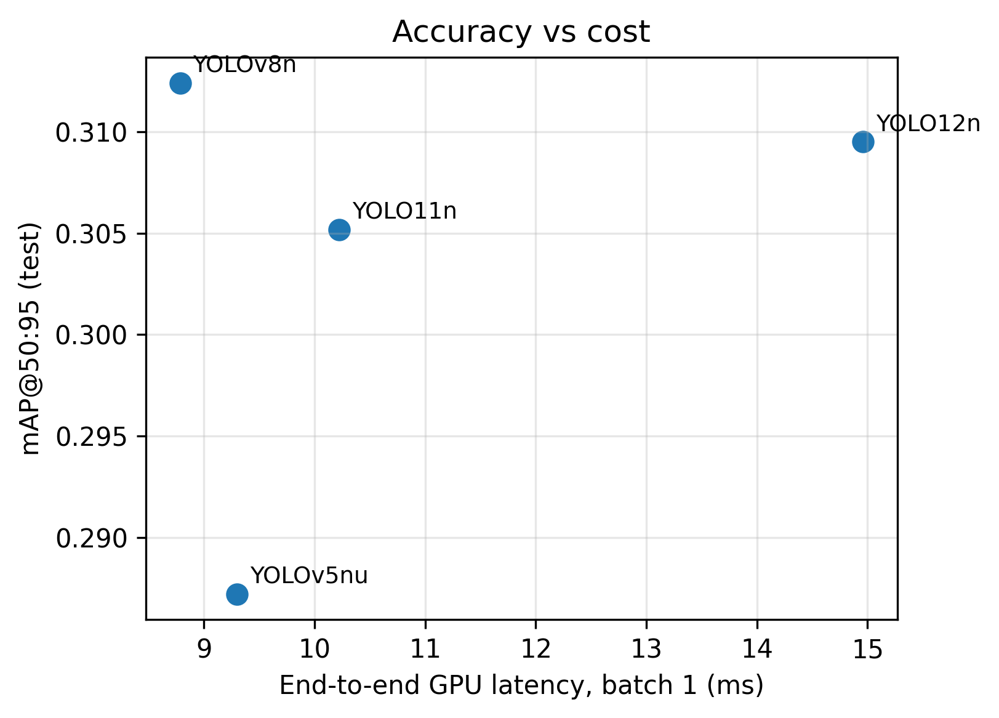<br>Accuracy vs. GPU latency | 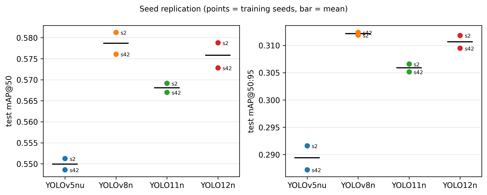<br>Seed replication |
| 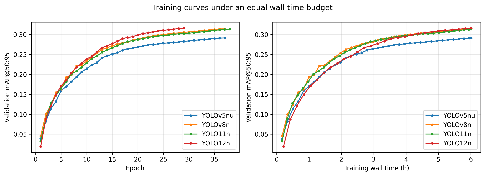<br>Training curves | 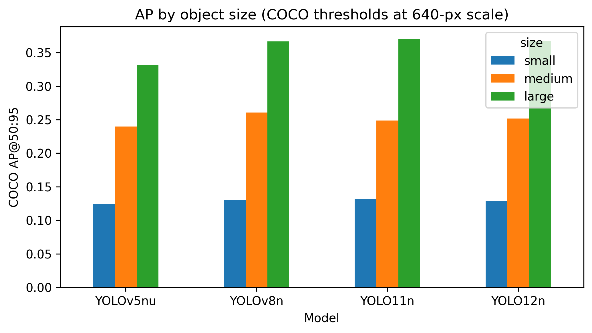<br>AP by object size |
| 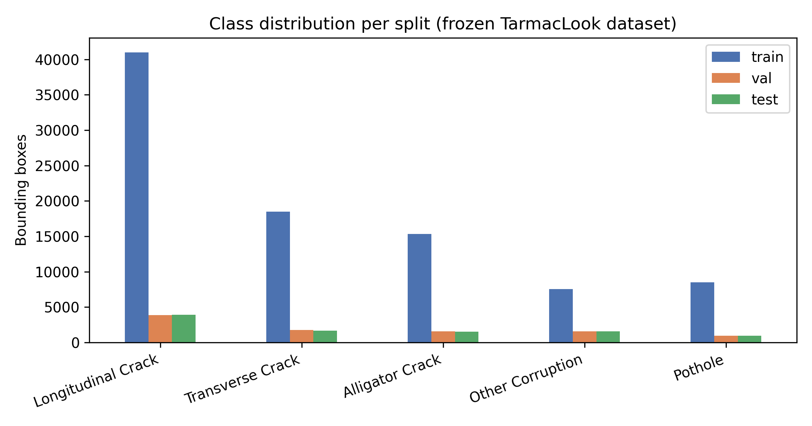<br>Class distribution | 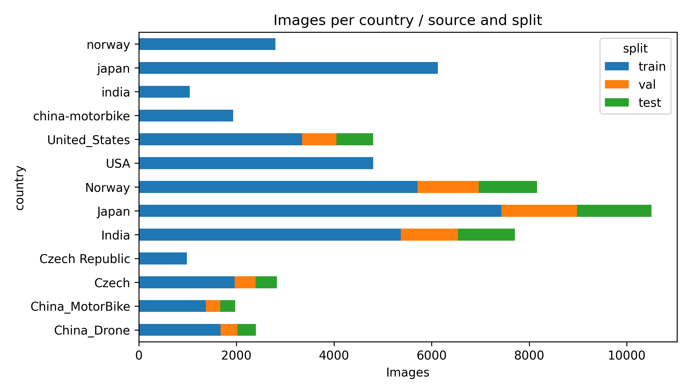<br>Images per country |

Full side-by-side predictions: [`results/figures/fig_qualitative.png`](results/figures/fig_qualitative.png)
</details>

---

## 🗂️ Dataset

| Split | Images | Boxes | Source |
| --- | ---: | ---: | --- |
| Train | 44,570 | 90,896 | RDD2022 (26,868) + N-RDD2024 (17,702) |
| Val | 5,758 | 9,741 | RDD2022 |
| Test | 5,758 | 9,675 | RDD2022 (held out, used only for final evaluation) |

The 5 classes are **Longitudinal Crack · Transverse Crack · Alligator Crack · Other Corruption · Pothole**. During the audit, 1,293 images with no mappable boxes were quarantined and exact duplicates were removed with MD5 hashes. The frozen dataset has the fingerprint `5606829e426849895f8ffa578e675f9fd7e30272ed2ccc2741df19e22f891ed1`.

## ⚙️ Training protocol

```text
imgsz 640 · batch 16 · SGD (lr0 0.01, momentum 0.937, wd 5e-4) · warmup 1 epoch
close_mosaic 3 · AMP · equal wall-time budget: 6.0 h per run · Ultralytics 8.4.215
evaluation: conf 0.001 · IoU 0.7 · max_det 300     deployment: conf 0.25 · IoU 0.7
```

The full config is in [`results/tables/protocol.json`](results/tables/protocol.json).

## ⚠️ Limitations

- **The budget cut training short.** Every run's best epoch was its last epoch, so these are budget-limited scores rather than converged ones. The ranking answers *"which nano model learns most in 6 h?"*
- **Two seeds** are enough to check that the ranking is stable, but not enough for tight variance estimates.
- **A data-leakage check is still pending.** N-RDD2024 is described as an edited version of RDD2022. A perceptual-hash near-duplicate check between the N-RDD2024 training images and the RDD2022 val/test images has not been done yet.
- The test set is RDD2022 only, so performance on other cameras and countries is not established.

---

## 🧪 Earlier experiments (pilots, not comparable)

These came before the frozen dataset and protocol. They are kept for history and **cannot be compared** with the results above.

| Experiment | Data | Metric | Value |
| --- | --- | --- | ---: |
| HOG + One-vs-Rest Linear SVM | RDD2022 subsample (8k/2k/2k) | test Macro-F1 (image-level) | 0.467 |
| Faster R-CNN ResNet18-FPN | 4,000/800 subset, 5 epochs | val mAP@50 | 0.181 |
| Faster R-CNN ResNet50-FPN | 4,000/800 subset, 5 epochs | val mAP@50 | 0.400 |
| Faster R-CNN MobileNetV3-L-FPN | 4,000/800 subset, 5 epochs | val mAP@50 | 0.290 |
| Faster R-CNN MobileNetV3-L-320-FPN | 4,000/800 subset, 5 epochs | val mAP@50 | 0.157 |
| YOLOv8n (Colab, 9 of 20 epochs) | old V_2.0.2 merge | val mAP@50 | 0.480 |

The ANN study (`notebooks/legacy/ANN PRACTICAL ON PROJECT.ipynb`) compares activation functions, early stopping and tuning on a separate classification task. It is not part of the road-damage benchmark.

---

## 🚧 Status & roadmap

| Component | Status |
| --- | --- |
| Dataset audit, merge & freeze | ✅ Done |
| Classical / Faster R-CNN pilots | ✅ Done |
| 4-model nano YOLO benchmark (equal budget) | ✅ Done |
| Seed replication + bootstrap statistics | ✅ Done |
| Near-duplicate leakage check (N-RDD2024 ↔ RDD2022) | 🚧 Next |
| Streamlit dashboard from the results bundle | 🚧 Next |
| Paper submission | 🚧 In progress |
| Road Health Index & road-segment mapping | ⬜ Planned |
| ONNX / TensorRT edge deployment | ⬜ Planned |
| Temporal damage tracking | ⬜ Future |

---

## 📁 Repository structure

```text
TarmacLook/
├── assets/                  animated README graphics (banner, pipeline, results, detections.gif)
├── notebooks/
│   ├── training/            02C / 02D — seed-2 training runs (v5nu+v8n, 11n+12n)
│   ├── evaluation/          03 — compare models, bootstrap stats, build the bundle
│   └── legacy/              V_1.x / V_2.x pilots and the ANN study
├── results/
│   ├── figures/             final paper figures (PNG)
│   └── tables/              final CSV tables + protocol.json
├── docs/                    literature review
└── README.md
```

## ▶️ Getting started

```bash
git clone https://github.com/GuptaPurab/TarmacLook.git
cd TarmacLook
pip install ultralytics==8.4.215
```

The training notebooks are written for **Kaggle (2× T4)** and read RDD2022 and N-RDD2024 from Kaggle Datasets. Open a notebook in `notebooks/training/`, attach the datasets, and run all cells. Then run `notebooks/evaluation/03_compare_and_bundle.ipynb` to rebuild the figures and tables in `results/`.

## 🧰 Tech stack

`Python` · `PyTorch` · `Ultralytics YOLO` · `pycocotools` · `OpenCV` · `NumPy` · `Pandas` · `Matplotlib` · `scikit-learn` · `Kaggle` · *planned:* `Streamlit` · `Folium` · `ONNX`

## 📜 License

This project is licensed under the **MIT License**.

---

<p align="center"><i>TarmacLook: building an intelligent, data-driven approach to road infrastructure monitoring.</i></p>
